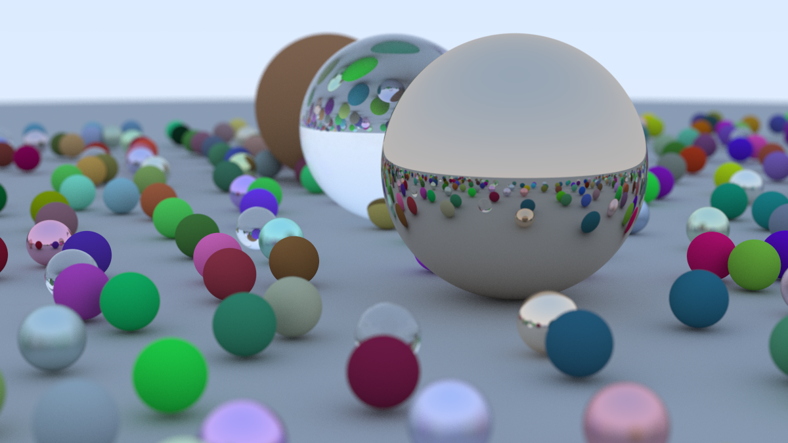

# PathTracer

A multithreaded CPU path tracer written from scratch in C++17, based on the *Ray Tracing in One Weekend* series. It renders physically-inspired scenes with diffuse, metal and glass materials, a positionable camera with depth of field, and a BVH for fast ray–scene intersection.



*A randomly generated scene rendered at 1200×675, 500 samples per pixel. [View the full-size image](output.png).*

## Features

- **Materials:** Lambertian (diffuse), metal with adjustable fuzz, and dielectric (glass) with refraction and total internal reflection
- **Camera:** Configurable field of view, look-from / look-at orientation, and defocus blur (depth of field)
- **Anti-aliasing:** Multiple jittered samples per pixel
- **Acceleration:** Bounding volume hierarchy (BVH) built over axis-aligned bounding boxes
- **Parallel rendering:** Scanlines are interleaved across all available hardware threads
- **Procedural scene:** A randomised field of small spheres surrounding three large feature spheres

## Getting started

### Requirements

- A C++17 compiler (MSVC, GCC or Clang)
- CMake 3.15 or newer

### Build

```bash
cmake -B build -S .
cmake --build build --config Release
```

### Run

```bash
# Windows
./build/Release/pathtracer.exe

# Linux / macOS
./build/pathtracer
```

The renderer reports progress on stderr and writes the result to `output.ppm` in the working directory. PPM files can be opened with most image viewers or converted to PNG with a tool such as ImageMagick:

```bash
magick output.ppm output.png
```

## Configuration

Render settings are set in [`src/main.cpp`](src/main.cpp):

```cpp
camera cam;

cam.aspect_ratio      = 16.0 / 9.0;
cam.image_width       = 1200;
cam.samples_per_pixel = 500;
cam.max_depth         = 50;

cam.vfov     = 20;
cam.lookfrom = point3(13, 2, 3);
cam.lookat   = point3(0, 0, 0);
cam.vup      = vec3(0, 1, 0);

cam.defocus_angle = 0.6;
cam.focus_dist    = 10.0;
```

Lower `image_width` and `samples_per_pixel` for quick previews. Rendering time scales roughly linearly with both the sample count and the number of pixels.

## Project structure

| File | Purpose |
| --- | --- |
| [`src/main.cpp`](src/main.cpp) | Scene construction and render settings |
| [`src/camera.h`](src/camera.h) | Camera model, ray generation, multithreaded render loop |
| [`src/material.h`](src/material.h) | Lambertian, metal and dielectric materials |
| [`src/sphere.h`](src/sphere.h) | Ray–sphere intersection |
| [`src/hittable.h`](src/hittable.h), [`src/hittable_list.h`](src/hittable_list.h) | Intersection interface and object collection |
| [`src/bvh.h`](src/bvh.h), [`src/aabb.h`](src/aabb.h) | Bounding volume hierarchy and bounding boxes |
| [`src/vec3.h`](src/vec3.h), [`src/ray.h`](src/ray.h), [`src/colour.h`](src/colour.h), [`src/common.h`](src/common.h) | Vector maths, rays, colour output and shared utilities |

## Possible improvements

If I were to take this further: a scene description file format, additional primitives (triangles and meshes), textures, light-emitting materials, and a live preview window instead of writing to disk.

## Author

Sheikh Muhammad Huzaifs